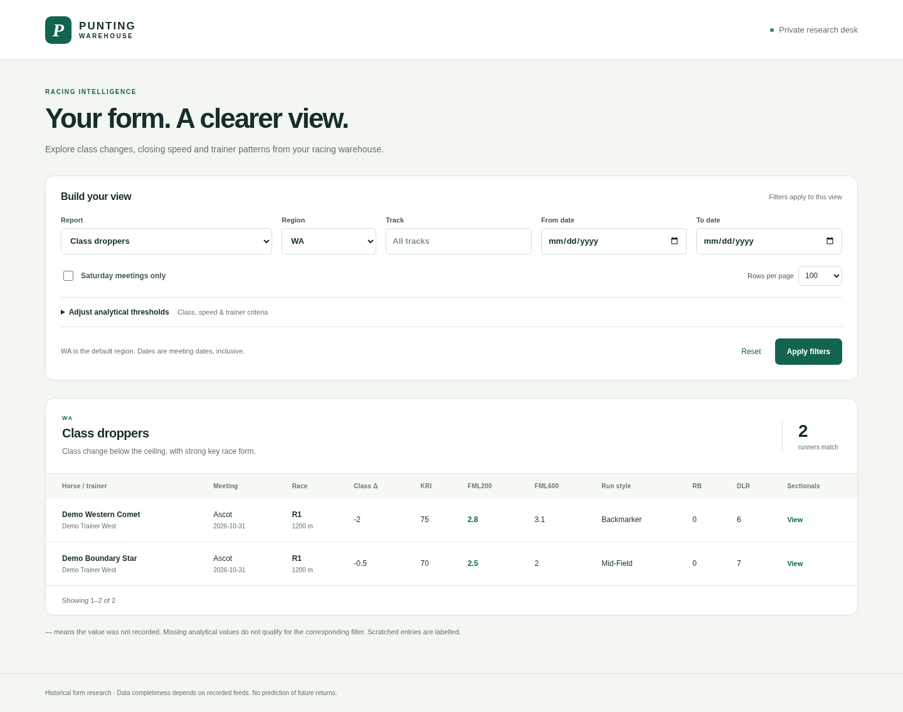
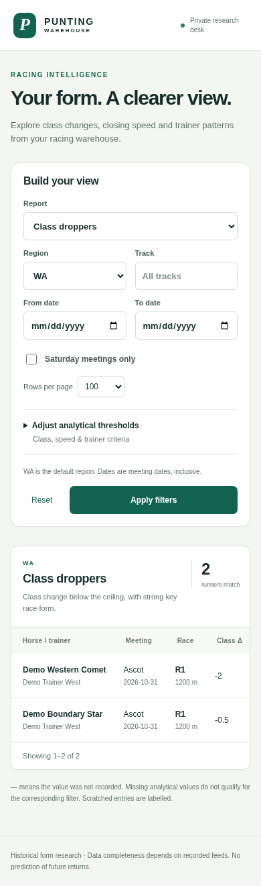

# HorseRiding — Racing Data Warehouse & Analytics

I built HorseRiding to turn racing feeds into an auditable database and a practical research dashboard. My goal was to make it easy to explore class changes, closing sectionals and trainer patterns without losing the original data behind a result.

The project includes a PostgreSQL warehouse, a Python ingestion pipeline, an authenticated FastAPI service, a responsive web interface and a Docker deployment stack. I designed it around one rule: **store everything, filter later**.

[Project walkthrough](docs/project-overview.md) · [Architecture](docs/architecture.md) · [API guide](docs/api.md) · [Results](docs/results.md) · [Deployment](docs/deployment.md)

## A look at the dashboard



<details>
<summary>Mobile view</summary>



</details>

The screenshots use fictional WA records so I can demonstrate the proprietary-metric filters without presenting invented ratings as real racing data.

## What I built

| Component | What it does |
| --- | --- |
| Raw-data warehouse | Retains original response bytes, checksums and source payloads before projecting relational records |
| Ingestion pipeline | Supports configurable HTTP feeds, historical imports, bounded retries, daily scheduling and repeatable refreshes |
| PostgreSQL schema | Separates meetings, races, runners and ordered 200 m sectionals; includes indexes and versioned migrations |
| Class-dropper scanner | Finds entries with `ClsDiff < 0` and `KRI >= 70`, with adjustable thresholds |
| Elite-closer scanner | Filters `FML200 >= 2.5` and selected running styles |
| Trainer reports | Calculates first-up and short-backup strike rates and flat-unit returns with explicit denominators |
| Secure interface | Uses Bearer authentication for the API and HTTP Basic for the browser, with HTTPS termination configured through Caddy |
| Operations | Includes Docker Compose, Perth-time cron, backup/restore scripts and GitHub Actions checks |

WA is the default query region. The ingestion layer preserves other acquired regions so I can change the filters without redesigning the warehouse.

## Results I verified

- **107 tests passed** in the PostgreSQL-enabled validation run on 6 November 2026, with **90% statement coverage**.
- Imported a real historical sample of **18 Hong Kong meetings, 160 races and 2,007 runners**.
- Independently reconciled the seven-day backup report against the source CSVs: **19 trainers, 59 starts, seven wins and 75.7 gross return units**.
- Checked the interface in Chromium at desktop and mobile sizes, including filter submission and sectional navigation.
- Exercised Docker startup, authentication, cron dispatch and an isolated database backup/restore.

The figures above describe software validation and historical arithmetic. They are not a profitability forecast. The [results report](docs/results.md) explains the data, test conditions and limitations.

## Current delivery status

The local application and deployment tooling are implemented and tested. Two external steps remain before I would call the original live deployment complete:

1. Validate the subscriber's Punting Form Professional V2 credentials, endpoints, pagination and field mappings against live WA data.
2. Deploy to the selected public server/domain and verify DNS, trusted HTTPS and remote access.

The public Hong Kong dataset supports real results and payout checks, but it does not supply Punting Form's KRI/FML ratings or WA coverage. I leave those unavailable fields null and test their filtering logic with labelled synthetic fixtures.

## Run the demonstration

Requirements: Docker Engine, Docker Compose v2 and Python 3.12+.

```sh
git clone https://github.com/MahmoudAsadi97/HorseRiding.git
cd HorseRiding
python3 scripts/init-env.py
docker compose -f compose.yaml -f deploy/compose.local.yaml up -d --build --wait postgres app
docker compose run --rm --no-deps \
  -v "$PWD/tests/fixtures/demo.json:/tmp/demo.json:ro" \
  app punting import-json /tmp/demo.json --endpoint synthetic-demo
python3 scripts/smoke.py
```

Open `http://127.0.0.1:8000` locally and sign in with `ADMIN_USERNAME` and `ADMIN_PASSWORD` from your private `.env`. The credential generator refuses to overwrite an existing file. This local configuration publishes HTTP only on loopback; the [production instructions](docs/deployment.md) use HTTPS.

The database is stored in a named Docker volume. `docker compose down` retains it; `docker compose down -v` removes it. Keep demonstration and production data in separate databases.

## Data and reproducibility

I used the historical [gdaley/hkracing dataset](https://www.kaggle.com/datasets/gdaley/hkracing), obtained through a pinned GitHub mirror. The full source contains 6,349 races and 79,447 runner records from 1997–2005. The importer verifies file sizes and SHA-256 hashes before use.

The repository includes the importer and [provenance manifest](data/public/source.json). Original CSVs are downloaded locally rather than redistributed here because I have not confirmed the original dataset's redistribution licence. [Data documentation](data/public/README.md) covers mappings, anonymized IDs, observed days since last run, payout calculations and import commands.

## Development

```sh
python3 -m venv .venv
.venv/bin/pip install --require-hashes -r requirements-dev.lock
.venv/bin/pip install --no-deps --no-build-isolation -e .
.venv/bin/ruff check src tests deploy scripts
.venv/bin/pytest --tb=short -q
```

For the full database suite, set `TEST_DATABASE_URL` privately to a disposable PostgreSQL administrative connection. The tests create and remove their own temporary database. Without it, PostgreSQL tests are explicitly skipped. See [validation details](docs/validation.md) for the complete checks.

## Repository guide

- `src/punting/` — ingestion, schema, queries, API and browser interface.
- `migrations/` — versioned database upgrades.
- `tests/` — regression tests and fictional demonstration data.
- `scripts/` — setup, imports, verification, backups and restores.
- `deploy/` — cron, migration startup, Caddy and Compose overrides.
- `docs/` — design, API, results, operations, screenshots and original specification.
- `data/public/` — source provenance and historical-data mapping notes.

I have included the original specification and a [milestone-by-milestone assessment](docs/results.md#milestone-status) so the implementation can be reviewed against its requirements.
