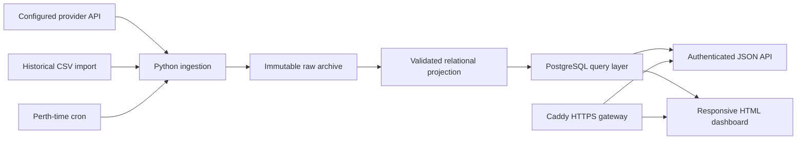

# Architecture and design decisions

I designed the system around source traceability: an analytical result should be explainable from retained source records.

## Storage

| Table | Responsibility |
| --- | --- |
| `raw_feeds` | Source bytes, SHA-256, response metadata, parsed payload where representable and normalization outcome |
| `meetings` | Date, track, state, rail, condition and moisture fields |
| `races` | Meeting relationship, race number, distance, class and par |
| `runners` | Race-entry identity, horse/trainer/jockey fields, analytical variables, result and payout data |
| `sectionals_200m` | Ordered splits, time/increment fields, raw finishing times and benchmark values |

Foreign keys enforce entity relationships. The runner/sequence index gives sectional records a unique order. Region/date and entity indexes support scoped queries. Alembic manages schema upgrades; startup applies them under a PostgreSQL advisory lock.

## Acquisition and projection

I keep geographic filters out of acquisition. WA is a default in the query layer, not a reason to discard acquired data. The HTTP adapter uses a configured HTTPS origin, bounded retries and credential-safe provenance. Endpoint mappings are configuration, and the included example is explicitly unverified against the subscriber's current Punting Form contract.

Ingestion owns its database session: source evidence is committed before projection can fail. Triggers protect source archive fields against ordinary update/delete operations. This is an application/database safeguard, not a claim of tamper-proof storage against a database administrator.

## Analytics

The class-dropper and elite-closer endpoints use explicit numeric boundaries and SQL parameters. Missing metrics do not qualify. Trainer reports distinguish settled starts from pending/scratched entries, include DNF and disqualified losses, and expose the priced cohort used for ROI.

I store published settlement returns separately from closing odds. A published return takes precedence; otherwise the query uses decimal price adjusted for a dead heat. This avoids applying a dead-heat reduction twice to a payout that already includes it.

## Application and deployment

The browser uses HTTP Basic authentication and the JSON routes require a Bearer token. Empty or insufficiently long credentials fail closed. HTML is escaped; security headers restrict scripts, framing and caching. Caddy supplies HTTPS in the public deployment configuration.

The production Compose stack publishes only the gateway. PostgreSQL and the non-root API stay on a private network. The scheduler has outbound access for ingestion. A loopback-only override supports local demonstrations. This is a single-host design, not a highly available distributed service.

## Deliberate limits

I have not validated the live subscriber endpoint contract or public certificate issuance. Source publication times, quota, pagination, correction windows and retention capacity must be checked before production ingestion is enabled. Backup and monitoring policies also need to match the customer's operating requirements.
